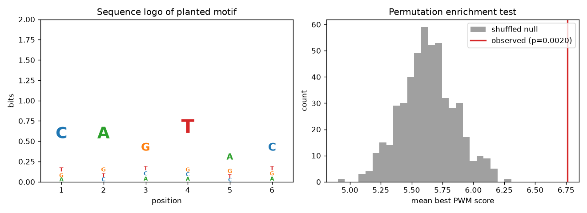

# motif-enrichment-scanner

A motif either lives in your promoters or it doesn't. The hard part is proving it's there more often than random chance would predict. This repo builds a position weight matrix (PWM) scanner from scratch and tests enrichment with a permutation null you can actually defend.

## Demo Output



The figure above was produced from simulated data by `demo.py`: a planted motif, a sequence logo, and a permutation-based enrichment p-value.

## Why This Exists

Most people reach for MEME or HOMER, get a pretty output, and never ask whether the enrichment call survives a proper null model. This project strips the method down to its bones so you can see exactly what a PWM score is, how a background is built, and why shuffling sequences (not just randomising scores) matters.

You give it:

- a set of target sequences (say, promoters of co-regulated genes)
- a PWM (a frequency matrix for a transcription factor)

It gives you:

- per-sequence best match scores
- a permutation p-value for enrichment against shuffled backgrounds

## How It Works

1. Convert the PWM to log-odds scores against a background base composition.
2. Slide the matrix across every sequence (both strands) and keep the best score.
3. Summarise the target set with a mean-of-maxima statistic.
4. Shuffle each sequence many times (preserving length and composition) and recompute the statistic to build a null distribution.
5. Report an empirical p-value.

## Decision Framework

| Your situation | Use this | Use something else |
|---|---|---|
| Teaching yourself how PWM scoring works | This repo | - |
| One known motif, one target gene set | This repo | - |
| De novo motif discovery | - | MEME / STREME |
| Genome-wide scanning at scale | - | FIMO / HOMER |
| You need matched GC background control | Extend the shuffler here | gkmSVM |

## When NOT to Use This

Don't use this to discover unknown motifs. It tests a motif you already have. If you don't know what you're looking for, you need a discovery tool, not a scanner. Also, dinucleotide-shuffle matters for GC-rich promoters; the simple mononucleotide shuffle here can inflate significance.

## The Uncomfortable Truth

A tiny p-value from a shuffled background only tells you the motif beats random sequence. It says nothing about whether the factor actually binds in vivo. Chromatin, cofactors, and accessibility decide that. A motif hit is a hypothesis, not a result.

## Quick Start

```bash
pip install -r requirements.txt
python demo.py
python scan.py --help
```

## Further Reading

- "Fitting a mixture model by expectation maximization to discover motifs in biopolymers" by Timothy L. Bailey and Charles Elkan
- "The MEME Suite" documentation by Timothy L. Bailey et al.
- "Biological Sequence Analysis" by Richard Durbin, Sean Eddy, Anders Krogh and Graeme Mitchison
